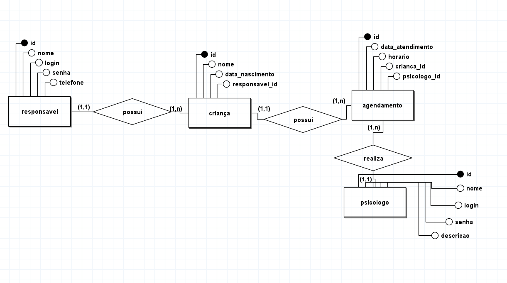
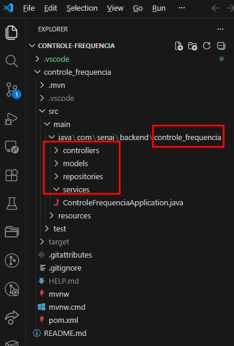
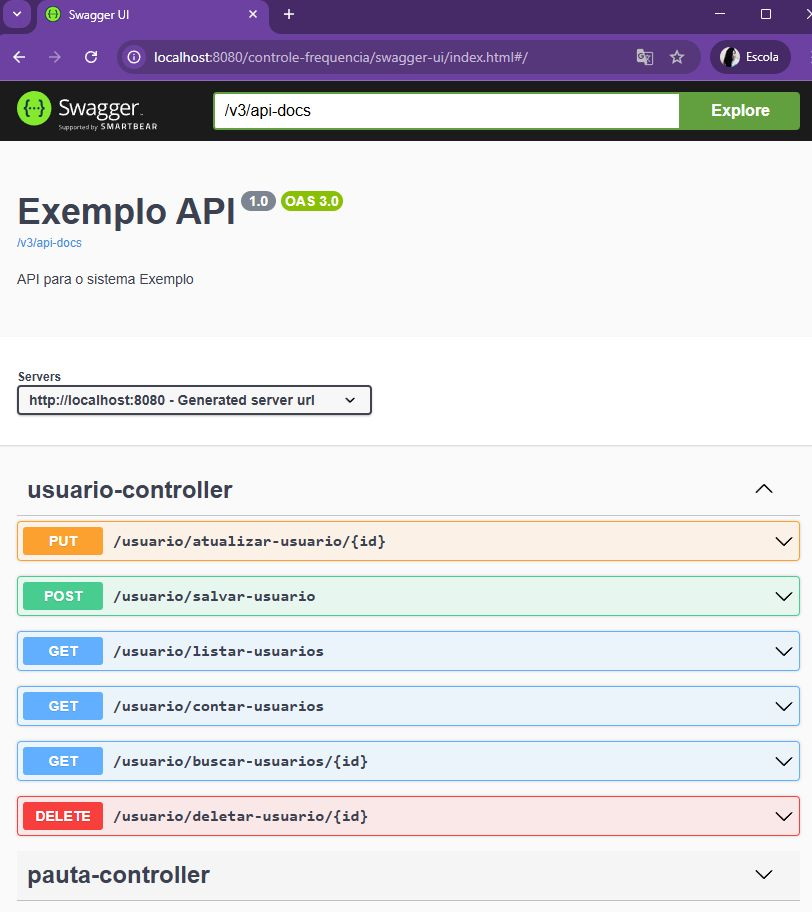

# API REST — Clínica (Responsáveis, Crianças, Psicólogos e Agendamentos)

API REST em **Java + Spring Boot** com **PostgreSQL**, autenticação **JWT** e documentação **Swagger**.
Segue o padrão MVC expandido do curso: `models → repositories → services → controllers`.

## Índice

1. [Tecnologias](#1-tecnologias)
2. [Requisitos funcionais](#2-requisitos-funcionais)
3. [Modelo de dados (MER) e regras de mapeamento](#3-modelo-de-dados-mer-e-regras-de-mapeamento)
4. [Como criar o projeto](#4-como-criar-o-projeto)
5. [Dependências extras (pom.xml)](#5-dependências-extras-pomxml)
6. [Configuração (application.properties)](#6-configuração-applicationproperties)
7. [Estrutura de pacotes](#7-estrutura-de-pacotes)
8. [Models](#8-models)
9. [Repositories](#9-repositories)
10. [Services](#10-services)
11. [Controllers](#11-controllers)
12. [Segurança com JWT](#12-segurança-com-jwt)
13. [Swagger](#13-swagger)
14. [Como executar e testar](#14-como-executar-e-testar)
15. [Endpoints](#15-endpoints)
16. [Erros comuns](#16-erros-comuns)
17. [Commit e push](#17-commit-e-push)

---

## 1. Tecnologias

| Tecnologia | Versão / uso |
|---|---|
| Java | 25 |
| Spring Boot | versão estável mais atual (Web, Data JPA, Security, DevTools) |
| PostgreSQL | 18 |
| JJWT | 0.12.6 (geração e validação do token) |
| Springdoc OpenAPI | 3.x para Spring Boot 4.x (2.x serve para Spring Boot 3.x) |
| Maven | via `mvnw` do projeto |
| VS Code | com Extension Pack for Java, Spring Boot Extension Pack e Spring Initializr |

## 2. Requisitos funcionais

| Requisito | Implementação |
|---|---|
| Autenticação | Login com JWT, falha de autenticação devolve **401**, retorno com **nome** do usuário, logout |
| Responsáveis | CRUD completo + **busca por termo** na listagem (`?termo=`) |
| Crianças | CRUD; no cadastro informa-se o `responsavel.id` |
| Agendamentos | CRUD; a listagem vem **ordenada por data** e mostra criança, responsável e psicólogo |

## 3. Modelo de dados (MER) e regras de mapeamento



| Entidade | Colunas | Relacionamento |
|---|---|---|
| `responsaveis` | id, nome, login, senha, telefone | 1 responsável possui N crianças |
| `criancas` | id, nome, data_nascimento, responsavel_id | 1 criança possui N agendamentos |
| `agendamentos` | id, data_atendimento, horario, crianca_id, psicologo_id | pertence a 1 criança e 1 psicólogo |
| `psicologo` | id, nome, login, senha, descricao | realiza N agendamentos; é quem faz login |

**Regras para espelhar o banco em Java**

| Item | Regra |
|---|---|
| Nome da tabela | `@Table(name)` **idêntico** ao `CREATE TABLE` do script (inclusive plural) |
| Nome da coluna | `@Column(name)` idêntico ao script |
| Atributo Java | camelCase, sem underline (`dataAtendimento`) |
| Tipos | DATE → `LocalDate`, TIME → `LocalTime`, VARCHAR → `String`, SERIAL → `Integer` |
| Chave estrangeira | `@ManyToOne` + `@JoinColumn` com o objeto da entidade relacionada (nunca `@OneToOne` para relação 1..N) |

> Com `spring.jpa.hibernate.ddl-auto=update`, se o nome da tabela na entidade for diferente do script, o Hibernate cria uma tabela nova e vazia e ignora a do script.
> Dica: troque temporariamente para `ddl-auto=validate` para o Hibernate apontar qualquer divergência.

## 4. Como criar o projeto

1. Crie o repositório no GitHub (privado, com README) e clone no VS Code (**Code → HTTPS → copiar**, depois **Clone Repository**).
2. Botão direito em um espaço vazio do Explorer → **New Java Project**.
3. Responda ao assistente do Spring Initializr:

| Pergunta | Resposta |
|---|---|
| Project type | Spring Boot |
| Build tool | Maven Project |
| Spring Boot version | a mais atual, **sem** sufixo M, RC ou SNAPSHOT |
| Language | Java |
| Group Id | `com.treino` |
| Artifact Id | `senai` |
| Package name | `com.treino.senai` |
| Packaging | Jar |
| Java version | 25 |
| Dependências | Spring Web, Spring Data JPA, PostgreSQL Driver, Spring Security, Spring Boot DevTools |

4. Salve na pasta do repositório clonado (a que contém a pasta oculta `.git`) e clique em **Add to Workspace**.

## 5. Dependências extras (pom.xml)

Cole dentro de `<dependencies>`:

```xml
<!-- JWT (JSON Web Token) -->
<dependency>
    <groupId>io.jsonwebtoken</groupId>
    <artifactId>jjwt-api</artifactId>
    <version>0.12.6</version>
</dependency>
<dependency>
    <groupId>io.jsonwebtoken</groupId>
    <artifactId>jjwt-impl</artifactId>
    <version>0.12.6</version>
    <scope>runtime</scope>
</dependency>
<dependency>
    <groupId>io.jsonwebtoken</groupId>
    <artifactId>jjwt-jackson</artifactId>
    <version>0.12.6</version>
    <scope>runtime</scope>
</dependency>

<!-- Swagger / OpenAPI (versão 3.x para Spring Boot 4.x) -->
<dependency>
    <groupId>org.springdoc</groupId>
    <artifactId>springdoc-openapi-starter-webmvc-ui</artifactId>
    <version>3.0.3</version>
</dependency>
```

> Springdoc **2.x** é para Spring Boot **3.x**. Para Spring Boot **4.x** use Springdoc **3.x**.
> Depois de salvar, clique em **Yes** se o VS Code perguntar sobre sincronizar o classpath.

## 6. Configuração (application.properties)

Arquivo `src/main/resources/application.properties`:

```properties
spring.application.name=senai
server.port=8080

# Banco de dados (o banco "clinica" precisa existir)
spring.datasource.url=jdbc:postgresql://localhost:5432/clinica
spring.datasource.username=postgres
spring.datasource.password=aluno
spring.datasource.driver-class-name=org.postgresql.Driver

# JPA / Hibernate
spring.jpa.hibernate.ddl-auto=update
spring.jpa.show-sql=true

# JWT: segredo com pelo menos 32 caracteres; validade em milissegundos (24 h)
jwt.secret=ChaveSecretaDaClinicaPsicologia2026ComMaisDe32Caracteres
jwt.expiration=86400000
```

| Propriedade | Função |
|---|---|
| `server.port` | Porta do servidor (use a mesma no Swagger/Postman) |
| `spring.datasource.url` | `jdbc:postgresql://localhost:5432/<nome_do_banco>` |
| `spring.datasource.username/password` | Credenciais do PostgreSQL |
| `spring.jpa.hibernate.ddl-auto` | `update` cria/ajusta tabelas; `validate` só confere |
| `jwt.secret` | Segredo do token, **mínimo 32 caracteres** |
| `jwt.expiration` | Validade do token em ms (86400000 = 24 h) |

## 7. Estrutura de pacotes

Todos os pacotes ficam **dentro** de `com.treino.senai`, em minúsculo e no plural:

```text
src/main/java/com/treino/senai/
|-- SenaiApplication.java
|-- configs/        SecurityConfig, JwtAuthFilter, CustomUserDetailsService, Swagger
|-- controllers/    AuthController, ResponsavelController, CriancaController,
|                   PsicologoController, AgendamentoController
|-- dtos/           LoginRequestDTO, LoginResponseDTO
|-- models/         Responsavel, Crianca, Psicologo, Agendamento
|-- repositories/   ResponsavelRepository, CriancaRepository,
|                   PsicologoRepository, AgendamentoRepository
|-- services/       ResponsavelService, CriancaService, PsicologoService,
|                   AgendamentoService, JwtService
src/main/resources/
|-- application.properties
```



## 8. Models

Cada entidade é uma classe `@Entity` que espelha uma tabela. Anotações usadas:

| Anotação | Função |
|---|---|
| `@Entity` | Define a classe como entidade JPA |
| `@Table(name = "...")` | Nome da tabela (igual ao script) |
| `@Id` + `@GeneratedValue(strategy = IDENTITY)` | Chave primária SERIAL |
| `@Column(name = "...")` | Nome da coluna |
| `@ManyToOne` + `@JoinColumn(name = "x_id")` | Chave estrangeira |
| `@JsonProperty(access = WRITE_ONLY)` | Aceita a senha na entrada do JSON, mas nunca a devolve |

**`models/Responsavel.java`**

```java
package com.treino.senai.models;

import com.fasterxml.jackson.annotation.JsonProperty;

import jakarta.persistence.Column;
import jakarta.persistence.Entity;
import jakarta.persistence.GeneratedValue;
import jakarta.persistence.GenerationType;
import jakarta.persistence.Id;
import jakarta.persistence.Table;

@Entity
@Table(name = "responsaveis")
public class Responsavel {

    @Id
    @GeneratedValue(strategy = GenerationType.IDENTITY)
    @Column(name = "id")
    private Integer id;

    @Column(name = "nome")
    private String nome;

    @Column(name = "login")
    private String login;

    // entra no JSON de cadastro, mas não é devolvido nas respostas
    @JsonProperty(access = JsonProperty.Access.WRITE_ONLY)
    @Column(name = "senha")
    private String senha;

    @Column(name = "telefone")
    private String telefone;

    public Responsavel() {
    }

    public Responsavel(Integer id, String nome, String login, String senha, String telefone) {
        this.id = id;
        this.nome = nome;
        this.login = login;
        this.senha = senha;
        this.telefone = telefone;
    }

    public Integer getId() { return id; }
    public void setId(Integer id) { this.id = id; }
    public String getNome() { return nome; }
    public void setNome(String nome) { this.nome = nome; }
    public String getLogin() { return login; }
    public void setLogin(String login) { this.login = login; }
    public String getSenha() { return senha; }
    public void setSenha(String senha) { this.senha = senha; }
    public String getTelefone() { return telefone; }
    public void setTelefone(String telefone) { this.telefone = telefone; }
}
```

**`models/Crianca.java`**

```java
package com.treino.senai.models;

import java.time.LocalDate;

import jakarta.persistence.Column;
import jakarta.persistence.Entity;
import jakarta.persistence.GeneratedValue;
import jakarta.persistence.GenerationType;
import jakarta.persistence.Id;
import jakarta.persistence.JoinColumn;
import jakarta.persistence.ManyToOne;
import jakarta.persistence.Table;

@Entity
@Table(name = "criancas")
public class Crianca {

    @Id
    @GeneratedValue(strategy = GenerationType.IDENTITY)
    @Column(name = "id")
    private Integer id;

    @Column(name = "nome")
    private String nome;

    @Column(name = "data_nascimento")
    private LocalDate dataNascimento;

    @ManyToOne
    @JoinColumn(name = "responsavel_id")
    private Responsavel responsavel;

    public Crianca() {
    }

    public Crianca(Integer id, String nome, LocalDate dataNascimento, Responsavel responsavel) {
        this.id = id;
        this.nome = nome;
        this.dataNascimento = dataNascimento;
        this.responsavel = responsavel;
    }

    public Integer getId() { return id; }
    public void setId(Integer id) { this.id = id; }
    public String getNome() { return nome; }
    public void setNome(String nome) { this.nome = nome; }
    public LocalDate getDataNascimento() { return dataNascimento; }
    public void setDataNascimento(LocalDate dataNascimento) { this.dataNascimento = dataNascimento; }
    public Responsavel getResponsavel() { return responsavel; }
    public void setResponsavel(Responsavel responsavel) { this.responsavel = responsavel; }
}
```

**`models/Psicologo.java`**

```java
package com.treino.senai.models;

import com.fasterxml.jackson.annotation.JsonProperty;

import jakarta.persistence.Column;
import jakarta.persistence.Entity;
import jakarta.persistence.GeneratedValue;
import jakarta.persistence.GenerationType;
import jakarta.persistence.Id;
import jakarta.persistence.Table;

@Entity
@Table(name = "psicologo")
public class Psicologo {

    @Id
    @GeneratedValue(strategy = GenerationType.IDENTITY)
    @Column(name = "id")
    private Integer id;

    @Column(name = "nome")
    private String nome;

    @Column(name = "login", unique = true)
    private String login;

    @JsonProperty(access = JsonProperty.Access.WRITE_ONLY)
    @Column(name = "senha")
    private String senha;

    // perfil de acesso: ADMIN ou OPERADOR
    @Column(name = "descricao")
    private String descricao;

    public Psicologo() {
    }

    public Psicologo(Integer id, String nome, String login, String senha, String descricao) {
        this.id = id;
        this.nome = nome;
        this.login = login;
        this.senha = senha;
        this.descricao = descricao;
    }

    public Integer getId() { return id; }
    public void setId(Integer id) { this.id = id; }
    public String getNome() { return nome; }
    public void setNome(String nome) { this.nome = nome; }
    public String getLogin() { return login; }
    public void setLogin(String login) { this.login = login; }
    public String getSenha() { return senha; }
    public void setSenha(String senha) { this.senha = senha; }
    public String getDescricao() { return descricao; }
    public void setDescricao(String descricao) { this.descricao = descricao; }
}
```

**`models/Agendamento.java`**

```java
package com.treino.senai.models;

import java.time.LocalDate;
import java.time.LocalTime;

import jakarta.persistence.Column;
import jakarta.persistence.Entity;
import jakarta.persistence.GeneratedValue;
import jakarta.persistence.GenerationType;
import jakarta.persistence.Id;
import jakarta.persistence.JoinColumn;
import jakarta.persistence.ManyToOne;
import jakarta.persistence.Table;

@Entity
@Table(name = "agendamentos")
public class Agendamento {

    @Id
    @GeneratedValue(strategy = GenerationType.IDENTITY)
    @Column(name = "id")
    private Integer id;

    @Column(name = "data_atendimento")
    private LocalDate dataAtendimento;

    @Column(name = "horario")
    private LocalTime horario;

    @ManyToOne
    @JoinColumn(name = "crianca_id")
    private Crianca crianca;

    @ManyToOne
    @JoinColumn(name = "psicologo_id")
    private Psicologo psicologo;

    public Agendamento() {
    }

    public Integer getId() { return id; }
    public void setId(Integer id) { this.id = id; }
    public LocalDate getDataAtendimento() { return dataAtendimento; }
    public void setDataAtendimento(LocalDate dataAtendimento) { this.dataAtendimento = dataAtendimento; }
    public LocalTime getHorario() { return horario; }
    public void setHorario(LocalTime horario) { this.horario = horario; }
    public Crianca getCrianca() { return crianca; }
    public void setCrianca(Crianca crianca) { this.crianca = crianca; }
    public Psicologo getPsicologo() { return psicologo; }
    public void setPsicologo(Psicologo psicologo) { this.psicologo = psicologo; }
}
```


## 9. Repositories

Interfaces que estendem `JpaRepository<Entidade, Integer>` (já trazem `save`, `findById`, `findAll`, `deleteById`, `existsById`, `count`). Só criamos método novo quando o enunciado pede algo além do CRUD.

**`repositories/ResponsavelRepository.java`**

```java
package com.treino.senai.repositories;

import java.util.List;

import org.springframework.data.jpa.repository.JpaRepository;
import org.springframework.stereotype.Repository;

import com.treino.senai.models.Responsavel;

@Repository
public interface ResponsavelRepository extends JpaRepository<Responsavel, Integer> {

    // busca por termo: o Spring monta o SELECT ... LIKE pelo nome do método
    List<Responsavel> findByNomeContainingIgnoreCase(String termo);
}
```

**`repositories/CriancaRepository.java`**

```java
package com.treino.senai.repositories;

import org.springframework.data.jpa.repository.JpaRepository;
import org.springframework.stereotype.Repository;

import com.treino.senai.models.Crianca;

@Repository
public interface CriancaRepository extends JpaRepository<Crianca, Integer> {
}
```

**`repositories/PsicologoRepository.java`**

```java
package com.treino.senai.repositories;

import java.util.Optional;

import org.springframework.data.jpa.repository.JpaRepository;
import org.springframework.stereotype.Repository;

import com.treino.senai.models.Psicologo;

@Repository
public interface PsicologoRepository extends JpaRepository<Psicologo, Integer> {

    // usado no login
    Optional<Psicologo> findByLogin(String login);
}
```

**`repositories/AgendamentoRepository.java`**

```java
package com.treino.senai.repositories;

import java.util.List;

import org.springframework.data.jpa.repository.JpaRepository;
import org.springframework.stereotype.Repository;

import com.treino.senai.models.Agendamento;

@Repository
public interface AgendamentoRepository extends JpaRepository<Agendamento, Integer> {

    // lista ordenada por data (e horário). Já traz criança, responsável e psicólogo
    List<Agendamento> findAllByOrderByDataAtendimentoAscHorarioAsc();
}
```

> `findAllByOrderByDataAtendimentoAscHorarioAsc` = todos, ordenados por `dataAtendimento` e depois por `horario`. `findByNomeContainingIgnoreCase` = nome contém o texto, ignorando maiúsculas. Os nomes usam os **atributos Java**, não as colunas.

## 10. Services

Todos seguem o mesmo molde: `contar`, `buscar`, `listar`, `deletar`, `cadastrar`, `atualizar`.

| Método | Retorno | O que faz |
|---|---|---|
| `contarX()` | Long | `repository.count()` |
| `buscarX(id)` | Entidade | `repository.findById(id).get()` |
| `listarXs()` | List | `repository.findAll()` |
| `deletarX(id)` | Boolean | se `existsById`: `deleteById` e `true`; senão `false` |
| `cadastrarX(obj)` | Entidade | `repository.save(obj)` |
| `atualizarX(id, obj)` | Entidade | busca o existente, altera só o que veio diferente de `null` e salva |

> No `atualizar`, busque pelo **id da URL**. Nunca use `setId(obj.getId())`: sem id no JSON, o `save()` cria um registro novo.
> Com `.get()`, um id inexistente devolve erro 500.

**`services/ResponsavelService.java`**

```java
package com.treino.senai.services;

import java.util.List;

import org.springframework.beans.factory.annotation.Autowired;
import org.springframework.security.crypto.password.PasswordEncoder;
import org.springframework.stereotype.Service;

import com.treino.senai.models.Responsavel;
import com.treino.senai.repositories.ResponsavelRepository;

@Service
public class ResponsavelService {

    @Autowired
    private ResponsavelRepository responsavelRepository;

    @Autowired
    private PasswordEncoder passwordEncoder;

    public Long contarResponsaveis() {
        return responsavelRepository.count();
    }

    public Responsavel buscarResponsavel(Integer id) {
        return responsavelRepository.findById(id).get();
    }

    // sem termo lista todos; com termo filtra pelo nome
    public List<Responsavel> listarResponsaveis(String termo) {
        if (termo == null || termo.isBlank()) {
            return responsavelRepository.findAll();
        }
        return responsavelRepository.findByNomeContainingIgnoreCase(termo);
    }

    public Boolean deletarResponsavel(Integer id) {
        if (responsavelRepository.existsById(id)) {
            responsavelRepository.deleteById(id);
            return true;
        }
        return false;
    }

    public Responsavel cadastrarResponsavel(Responsavel responsavel) {
        responsavel.setSenha(passwordEncoder.encode(responsavel.getSenha()));
        return responsavelRepository.save(responsavel);
    }

    public Responsavel atualizarResponsavel(Integer id, Responsavel responsavel) {
        Responsavel responsavelRecuperado = buscarResponsavel(id);
        if (responsavelRecuperado != null) {
            if (responsavel.getNome() != null) {
                responsavelRecuperado.setNome(responsavel.getNome());
            }
            if (responsavel.getLogin() != null) {
                responsavelRecuperado.setLogin(responsavel.getLogin());
            }
            if (responsavel.getTelefone() != null) {
                responsavelRecuperado.setTelefone(responsavel.getTelefone());
            }
            if (responsavel.getSenha() != null) {
                responsavelRecuperado.setSenha(passwordEncoder.encode(responsavel.getSenha()));
            }
            return responsavelRepository.save(responsavelRecuperado);
        }
        return null;
    }
}
```

**`services/CriancaService.java`**

```java
package com.treino.senai.services;

import java.util.List;

import org.springframework.beans.factory.annotation.Autowired;
import org.springframework.stereotype.Service;

import com.treino.senai.models.Crianca;
import com.treino.senai.repositories.CriancaRepository;

@Service
public class CriancaService {

    @Autowired
    private CriancaRepository criancaRepository;

    @Autowired
    private ResponsavelService responsavelService;

    public Long contarCriancas() {
        return criancaRepository.count();
    }

    public Crianca buscarCrianca(Integer id) {
        return criancaRepository.findById(id).get();
    }

    public List<Crianca> listarCriancas() {
        return criancaRepository.findAll();
    }

    public Boolean deletarCrianca(Integer id) {
        if (criancaRepository.existsById(id)) {
            criancaRepository.deleteById(id);
            return true;
        }
        return false;
    }

    // a criança é cadastrada já associada a um responsável existente
    public Crianca cadastrarCrianca(Crianca crianca) {
        crianca.setResponsavel(
                responsavelService.buscarResponsavel(crianca.getResponsavel().getId()));
        return criancaRepository.save(crianca);
    }

    public Crianca atualizarCrianca(Integer id, Crianca crianca) {
        Crianca criancaRecuperada = buscarCrianca(id);
        if (criancaRecuperada != null) {
            if (crianca.getNome() != null) {
                criancaRecuperada.setNome(crianca.getNome());
            }
            if (crianca.getDataNascimento() != null) {
                criancaRecuperada.setDataNascimento(crianca.getDataNascimento());
            }
            if (crianca.getResponsavel() != null) {
                criancaRecuperada.setResponsavel(
                        responsavelService.buscarResponsavel(crianca.getResponsavel().getId()));
            }
            return criancaRepository.save(criancaRecuperada);
        }
        return null;
    }
}
```

**`services/PsicologoService.java`**

```java
package com.treino.senai.services;

import java.util.List;

import org.springframework.beans.factory.annotation.Autowired;
import org.springframework.security.crypto.password.PasswordEncoder;
import org.springframework.stereotype.Service;

import com.treino.senai.models.Psicologo;
import com.treino.senai.repositories.PsicologoRepository;

@Service
public class PsicologoService {

    @Autowired
    private PsicologoRepository psicologoRepository;

    @Autowired
    private PasswordEncoder passwordEncoder;

    public Long contarPsicologos() {
        return psicologoRepository.count();
    }

    public Psicologo buscarPsicologo(Integer id) {
        return psicologoRepository.findById(id).get();
    }

    public List<Psicologo> listarPsicologos() {
        return psicologoRepository.findAll();
    }

    public Boolean deletarPsicologo(Integer id) {
        if (psicologoRepository.existsById(id)) {
            psicologoRepository.deleteById(id);
            return true;
        }
        return false;
    }

    public Psicologo cadastrarPsicologo(Psicologo psicologo) {
        psicologo.setSenha(passwordEncoder.encode(psicologo.getSenha()));
        return psicologoRepository.save(psicologo);
    }

    public Psicologo atualizarPsicologo(Integer id, Psicologo psicologo) {
        Psicologo psicologoRecuperado = buscarPsicologo(id);
        if (psicologoRecuperado != null) {
            if (psicologo.getNome() != null) {
                psicologoRecuperado.setNome(psicologo.getNome());
            }
            if (psicologo.getLogin() != null) {
                psicologoRecuperado.setLogin(psicologo.getLogin());
            }
            if (psicologo.getDescricao() != null) {
                psicologoRecuperado.setDescricao(psicologo.getDescricao());
            }
            if (psicologo.getSenha() != null) {
                psicologoRecuperado.setSenha(passwordEncoder.encode(psicologo.getSenha()));
            }
            return psicologoRepository.save(psicologoRecuperado);
        }
        return null;
    }
}
```

**`services/AgendamentoService.java`**

```java
package com.treino.senai.services;

import java.util.List;

import org.springframework.beans.factory.annotation.Autowired;
import org.springframework.stereotype.Service;

import com.treino.senai.models.Agendamento;
import com.treino.senai.repositories.AgendamentoRepository;

@Service
public class AgendamentoService {

    @Autowired
    private AgendamentoRepository agendamentoRepository;

    @Autowired
    private CriancaService criancaService;

    @Autowired
    private PsicologoService psicologoService;

    public Long contarAgendamentos() {
        return agendamentoRepository.count();
    }

    public Agendamento buscarAgendamento(Integer id) {
        return agendamentoRepository.findById(id).get();
    }

    // ordenados por data e horário
    public List<Agendamento> listarAgendamentos() {
        return agendamentoRepository.findAllByOrderByDataAtendimentoAscHorarioAsc();
    }

    public Boolean deletarAgendamento(Integer id) {
        if (agendamentoRepository.existsById(id)) {
            agendamentoRepository.deleteById(id);
            return true;
        }
        return false;
    }

    public Agendamento cadastrarAgendamento(Agendamento agendamento) {
        agendamento.setCrianca(
                criancaService.buscarCrianca(agendamento.getCrianca().getId()));
        agendamento.setPsicologo(
                psicologoService.buscarPsicologo(agendamento.getPsicologo().getId()));
        return agendamentoRepository.save(agendamento);
    }

    public Agendamento atualizarAgendamento(Integer id, Agendamento agendamento) {
        Agendamento agendamentoRecuperado = buscarAgendamento(id);
        if (agendamentoRecuperado != null) {
            if (agendamento.getDataAtendimento() != null) {
                agendamentoRecuperado.setDataAtendimento(agendamento.getDataAtendimento());
            }
            if (agendamento.getHorario() != null) {
                agendamentoRecuperado.setHorario(agendamento.getHorario());
            }
            if (agendamento.getCrianca() != null) {
                agendamentoRecuperado.setCrianca(
                        criancaService.buscarCrianca(agendamento.getCrianca().getId()));
            }
            if (agendamento.getPsicologo() != null) {
                agendamentoRecuperado.setPsicologo(
                        psicologoService.buscarPsicologo(agendamento.getPsicologo().getId()));
            }
            return agendamentoRepository.save(agendamentoRecuperado);
        }
        return null;
    }
}
```


## 11. Controllers

| Anotação | Função |
|---|---|
| `@RestController` | Controlador REST (devolve JSON) |
| `@RequestMapping("/responsavel")` | Caminho base da classe |
| `@GetMapping`, `@PostMapping`, `@PutMapping`, `@DeleteMapping` | Método HTTP + caminho |
| `@PathVariable` | Valor na URL (`/buscar-responsavel/{id}`) |
| `@RequestParam` | Valor na query (`?termo=ana`) |
| `@RequestBody` | Objeto JSON no corpo |
| `@Autowired` | Traz o service para dentro da classe |

**`controllers/ResponsavelController.java`**

```java
package com.treino.senai.controllers;

import java.util.List;

import org.springframework.beans.factory.annotation.Autowired;
import org.springframework.web.bind.annotation.DeleteMapping;
import org.springframework.web.bind.annotation.GetMapping;
import org.springframework.web.bind.annotation.PathVariable;
import org.springframework.web.bind.annotation.PostMapping;
import org.springframework.web.bind.annotation.PutMapping;
import org.springframework.web.bind.annotation.RequestBody;
import org.springframework.web.bind.annotation.RequestMapping;
import org.springframework.web.bind.annotation.RequestParam;
import org.springframework.web.bind.annotation.RestController;

import com.treino.senai.models.Responsavel;
import com.treino.senai.services.ResponsavelService;

@RestController
@RequestMapping("/responsavel")
public class ResponsavelController {

    @Autowired
    private ResponsavelService responsavelService;

    @GetMapping("/contar-responsaveis")
    public Long contarResponsaveis() {
        return responsavelService.contarResponsaveis();
    }

    @GetMapping("/buscar-responsavel/{id}")
    public Responsavel buscarResponsavel(@PathVariable Integer id) {
        return responsavelService.buscarResponsavel(id);
    }

    // /listar-responsaveis  ou  /listar-responsaveis?termo=ana
    @GetMapping("/listar-responsaveis")
    public List<Responsavel> listarResponsaveis(@RequestParam(required = false) String termo) {
        return responsavelService.listarResponsaveis(termo);
    }

    @DeleteMapping("/deletar-responsavel/{id}")
    public String deletarResponsavel(@PathVariable Integer id) {
        if (responsavelService.deletarResponsavel(id)) {
            return "Responsável removido com sucesso.";
        }
        return "Falha ao remover responsável.";
    }

    @PostMapping("/salvar-responsavel")
    public Responsavel cadastrarResponsavel(@RequestBody Responsavel responsavel) {
        return responsavelService.cadastrarResponsavel(responsavel);
    }

    @PutMapping("/atualizar-responsavel/{id}")
    public String atualizarResponsavel(@PathVariable Integer id,
                                       @RequestBody Responsavel responsavel) {
        if (responsavelService.atualizarResponsavel(id, responsavel) != null) {
            return "Responsável atualizado com sucesso.";
        }
        return "Falha ao atualizar responsável.";
    }
}
```

**`controllers/CriancaController.java`**

```java
package com.treino.senai.controllers;

import java.util.List;

import org.springframework.beans.factory.annotation.Autowired;
import org.springframework.web.bind.annotation.DeleteMapping;
import org.springframework.web.bind.annotation.GetMapping;
import org.springframework.web.bind.annotation.PathVariable;
import org.springframework.web.bind.annotation.PostMapping;
import org.springframework.web.bind.annotation.PutMapping;
import org.springframework.web.bind.annotation.RequestBody;
import org.springframework.web.bind.annotation.RequestMapping;
import org.springframework.web.bind.annotation.RestController;

import com.treino.senai.models.Crianca;
import com.treino.senai.services.CriancaService;

@RestController
@RequestMapping("/crianca")
public class CriancaController {

    @Autowired
    private CriancaService criancaService;

    @GetMapping("/contar-criancas")
    public Long contarCriancas() {
        return criancaService.contarCriancas();
    }

    @GetMapping("/buscar-crianca/{id}")
    public Crianca buscarCrianca(@PathVariable Integer id) {
        return criancaService.buscarCrianca(id);
    }

    @GetMapping("/listar-criancas")
    public List<Crianca> listarCriancas() {
        return criancaService.listarCriancas();
    }

    @DeleteMapping("/deletar-crianca/{id}")
    public String deletarCrianca(@PathVariable Integer id) {
        if (criancaService.deletarCrianca(id)) {
            return "Criança removida com sucesso.";
        }
        return "Falha ao remover criança.";
    }

    @PostMapping("/salvar-crianca")
    public Crianca cadastrarCrianca(@RequestBody Crianca crianca) {
        return criancaService.cadastrarCrianca(crianca);
    }

    @PutMapping("/atualizar-crianca/{id}")
    public String atualizarCrianca(@PathVariable Integer id, @RequestBody Crianca crianca) {
        if (criancaService.atualizarCrianca(id, crianca) != null) {
            return "Criança atualizada com sucesso.";
        }
        return "Falha ao atualizar criança.";
    }
}
```

**`controllers/AgendamentoController.java`**

```java
package com.treino.senai.controllers;

import java.util.List;

import org.springframework.beans.factory.annotation.Autowired;
import org.springframework.web.bind.annotation.DeleteMapping;
import org.springframework.web.bind.annotation.GetMapping;
import org.springframework.web.bind.annotation.PathVariable;
import org.springframework.web.bind.annotation.PostMapping;
import org.springframework.web.bind.annotation.PutMapping;
import org.springframework.web.bind.annotation.RequestBody;
import org.springframework.web.bind.annotation.RequestMapping;
import org.springframework.web.bind.annotation.RestController;

import com.treino.senai.models.Agendamento;
import com.treino.senai.services.AgendamentoService;

@RestController
@RequestMapping("/agendamento")
public class AgendamentoController {

    @Autowired
    private AgendamentoService agendamentoService;

    @GetMapping("/contar-agendamentos")
    public Long contarAgendamentos() {
        return agendamentoService.contarAgendamentos();
    }

    @GetMapping("/buscar-agendamento/{id}")
    public Agendamento buscarAgendamento(@PathVariable Integer id) {
        return agendamentoService.buscarAgendamento(id);
    }

    @GetMapping("/listar-agendamentos")
    public List<Agendamento> listarAgendamentos() {
        return agendamentoService.listarAgendamentos();
    }

    @DeleteMapping("/deletar-agendamento/{id}")
    public String deletarAgendamento(@PathVariable Integer id) {
        if (agendamentoService.deletarAgendamento(id)) {
            return "Agendamento removido com sucesso.";
        }
        return "Falha ao remover agendamento.";
    }

    @PostMapping("/salvar-agendamento")
    public Agendamento cadastrarAgendamento(@RequestBody Agendamento agendamento) {
        return agendamentoService.cadastrarAgendamento(agendamento);
    }

    @PutMapping("/atualizar-agendamento/{id}")
    public String atualizarAgendamento(@PathVariable Integer id,
                                       @RequestBody Agendamento agendamento) {
        if (agendamentoService.atualizarAgendamento(id, agendamento) != null) {
            return "Agendamento atualizado com sucesso.";
        }
        return "Falha ao atualizar agendamento.";
    }
}
```

**`controllers/PsicologoController.java`**

```java
package com.treino.senai.controllers;

import java.util.List;

import org.springframework.beans.factory.annotation.Autowired;
import org.springframework.web.bind.annotation.DeleteMapping;
import org.springframework.web.bind.annotation.GetMapping;
import org.springframework.web.bind.annotation.PathVariable;
import org.springframework.web.bind.annotation.PostMapping;
import org.springframework.web.bind.annotation.PutMapping;
import org.springframework.web.bind.annotation.RequestBody;
import org.springframework.web.bind.annotation.RequestMapping;
import org.springframework.web.bind.annotation.RestController;

import com.treino.senai.models.Psicologo;
import com.treino.senai.services.PsicologoService;

@RestController
@RequestMapping("/psicologo")
public class PsicologoController {

    @Autowired
    private PsicologoService psicologoService;

    @GetMapping("/contar-psicologos")
    public Long contarPsicologos() {
        return psicologoService.contarPsicologos();
    }

    @GetMapping("/buscar-psicologo/{id}")
    public Psicologo buscarPsicologo(@PathVariable Integer id) {
        return psicologoService.buscarPsicologo(id);
    }

    @GetMapping("/listar-psicologos")
    public List<Psicologo> listarPsicologos() {
        return psicologoService.listarPsicologos();
    }

    @DeleteMapping("/deletar-psicologo/{id}")
    public String deletarPsicologo(@PathVariable Integer id) {
        if (psicologoService.deletarPsicologo(id)) {
            return "Psicólogo removido com sucesso.";
        }
        return "Falha ao remover psicólogo.";
    }

    @PostMapping("/salvar-psicologo")
    public Psicologo cadastrarPsicologo(@RequestBody Psicologo psicologo) {
        return psicologoService.cadastrarPsicologo(psicologo);
    }

    @PutMapping("/atualizar-psicologo/{id}")
    public String atualizarPsicologo(@PathVariable Integer id, @RequestBody Psicologo psicologo) {
        if (psicologoService.atualizarPsicologo(id, psicologo) != null) {
            return "Psicólogo atualizado com sucesso.";
        }
        return "Falha ao atualizar psicólogo.";
    }
}
```


## 12. Segurança com JWT

O login devolve um token assinado; o cliente o envia nas próximas requisições em `Authorization: Bearer <token>`. A API não guarda sessão (stateless).

```text
1. POST /auth/login {login, senha}
        -> confere a senha (BCrypt) e gera o token
        <- 200 {token, nome, login, perfil}          (senha errada: 401)

2. GET /responsavel/listar-responsaveis  +  Authorization: Bearer <token>
        -> JwtAuthFilter valida o token e autentica o usuário
        <- 200 com os dados   (sem token ou token inválido: 401)
```

| Classe | Pacote | Papel |
|---|---|---|
| `JwtService` | services | Gera o token, extrai o login e valida |
| `CustomUserDetailsService` | configs | Busca o usuário no banco (tabela `psicologo`) |
| `JwtAuthFilter` | configs | Lê o Bearer token a cada requisição e autentica |
| `SecurityConfig` | configs | Rotas públicas, BCrypt, CORS e política stateless |
| `LoginRequestDTO` / `LoginResponseDTO` | dtos | Entrada e saída do login |
| `AuthController` | controllers | Login e logout |

**`dtos/LoginRequestDTO.java`**

```java
package com.treino.senai.dtos;

public class LoginRequestDTO {

    private String login;
    private String senha;

    public LoginRequestDTO() {
    }

    public String getLogin() { return login; }
    public void setLogin(String login) { this.login = login; }
    public String getSenha() { return senha; }
    public void setSenha(String senha) { this.senha = senha; }
}
```

**`dtos/LoginResponseDTO.java`**

```java
package com.treino.senai.dtos;

// devolvido no login: token + nome do usuário logado
public class LoginResponseDTO {

    private String token;
    private String nome;
    private String login;
    private String perfil;

    public LoginResponseDTO(String token, String nome, String login, String perfil) {
        this.token = token;
        this.nome = nome;
        this.login = login;
        this.perfil = perfil;
    }

    public String getToken() { return token; }
    public String getNome() { return nome; }
    public String getLogin() { return login; }
    public String getPerfil() { return perfil; }
}
```

**`services/JwtService.java`**

```java
package com.treino.senai.services;

import java.nio.charset.StandardCharsets;
import java.util.Date;

import javax.crypto.SecretKey;

import org.springframework.beans.factory.annotation.Value;
import org.springframework.stereotype.Service;

import io.jsonwebtoken.Jwts;
import io.jsonwebtoken.security.Keys;

@Service
public class JwtService {

    @Value("${jwt.secret}")
    private String secret;

    @Value("${jwt.expiration}")
    private long expiracao;

    private SecretKey chave() {
        return Keys.hmacShaKeyFor(secret.getBytes(StandardCharsets.UTF_8));
    }

    public String gerarToken(String login, String perfil) {
        return Jwts.builder()
                .subject(login)
                .claim("perfil", perfil)
                .issuedAt(new Date())
                .expiration(new Date(System.currentTimeMillis() + expiracao))
                .signWith(chave())
                .compact();
    }

    public String extrairLogin(String token) {
        return Jwts.parser().verifyWith(chave()).build()
                .parseSignedClaims(token).getPayload().getSubject();
    }

    public boolean isValido(String token) {
        try {
            Jwts.parser().verifyWith(chave()).build().parseSignedClaims(token);
            return true;
        } catch (Exception e) {
            return false;
        }
    }
}
```

**`configs/CustomUserDetailsService.java`**

```java
package com.treino.senai.configs;

import org.springframework.beans.factory.annotation.Autowired;
import org.springframework.security.core.userdetails.User;
import org.springframework.security.core.userdetails.UserDetails;
import org.springframework.security.core.userdetails.UserDetailsService;
import org.springframework.security.core.userdetails.UsernameNotFoundException;
import org.springframework.stereotype.Service;

import com.treino.senai.models.Psicologo;
import com.treino.senai.repositories.PsicologoRepository;

@Service
public class CustomUserDetailsService implements UserDetailsService {

    @Autowired
    private PsicologoRepository psicologoRepository;

    @Override
    public UserDetails loadUserByUsername(String login) throws UsernameNotFoundException {
        Psicologo p = psicologoRepository.findByLogin(login)
                .orElseThrow(() -> new UsernameNotFoundException("Usuário não encontrado"));
        return User.builder()
                .username(p.getLogin())
                .password(p.getSenha())
                .roles(p.getDescricao())
                .build();
    }
}
```

**`configs/JwtAuthFilter.java`**

```java
package com.treino.senai.configs;

import java.io.IOException;
import java.util.List;

import org.springframework.beans.factory.annotation.Autowired;
import org.springframework.security.authentication.UsernamePasswordAuthenticationToken;
import org.springframework.security.core.authority.SimpleGrantedAuthority;
import org.springframework.security.core.context.SecurityContextHolder;
import org.springframework.stereotype.Component;
import org.springframework.web.filter.OncePerRequestFilter;

import com.treino.senai.repositories.PsicologoRepository;
import com.treino.senai.services.JwtService;

import jakarta.servlet.FilterChain;
import jakarta.servlet.ServletException;
import jakarta.servlet.http.HttpServletRequest;
import jakarta.servlet.http.HttpServletResponse;

@Component
public class JwtAuthFilter extends OncePerRequestFilter {

    @Autowired
    private JwtService jwtService;

    @Autowired
    private PsicologoRepository psicologoRepository;

    @Override
    protected void doFilterInternal(HttpServletRequest request, HttpServletResponse response,
                                    FilterChain chain) throws ServletException, IOException {
        String header = request.getHeader("Authorization");

        if (header != null && header.startsWith("Bearer ")) {
            String token = header.substring(7);
            if (jwtService.isValido(token)) {
                String login = jwtService.extrairLogin(token);
                psicologoRepository.findByLogin(login).ifPresent(p -> {
                    var auth = new UsernamePasswordAuthenticationToken(p.getLogin(), null,
                            List.of(new SimpleGrantedAuthority("ROLE_" + p.getDescricao())));
                    SecurityContextHolder.getContext().setAuthentication(auth);
                });
            }
        }
        chain.doFilter(request, response);
    }
}
```

**`configs/SecurityConfig.java`**

```java
package com.treino.senai.configs;

import java.util.List;

import org.springframework.beans.factory.annotation.Autowired;
import org.springframework.context.annotation.Bean;
import org.springframework.context.annotation.Configuration;
import org.springframework.http.HttpStatus;
import org.springframework.security.authentication.AuthenticationManager;
import org.springframework.security.config.annotation.authentication.configuration.*;
import org.springframework.security.config.annotation.web.builders.HttpSecurity;
import org.springframework.security.config.annotation.web.configuration.EnableWebSecurity;
import org.springframework.security.config.http.SessionCreationPolicy;
import org.springframework.security.crypto.bcrypt.BCryptPasswordEncoder;
import org.springframework.security.crypto.password.PasswordEncoder;
import org.springframework.security.web.SecurityFilterChain;
import org.springframework.security.web.authentication.HttpStatusEntryPoint;
import org.springframework.security.web.authentication.UsernamePasswordAuthenticationFilter;
import org.springframework.web.cors.CorsConfiguration;
import org.springframework.web.cors.CorsConfigurationSource;
import org.springframework.web.cors.UrlBasedCorsConfigurationSource;

@Configuration
@EnableWebSecurity
public class SecurityConfig {

    @Autowired
    private JwtAuthFilter jwtAuthFilter;

    @Bean
    public PasswordEncoder passwordEncoder() {
        return new BCryptPasswordEncoder();
    }

    @Bean
    public AuthenticationManager authenticationManager(AuthenticationConfiguration config)
            throws Exception {
        return config.getAuthenticationManager();
    }

    @Bean
    public SecurityFilterChain filterChain(HttpSecurity http) throws Exception {
        http.csrf(csrf -> csrf.disable())
            .cors(cors -> cors.configurationSource(corsConfigurationSource()))
            .sessionManagement(s -> s.sessionCreationPolicy(SessionCreationPolicy.STATELESS))
            .exceptionHandling(e -> e.authenticationEntryPoint(
                    new HttpStatusEntryPoint(HttpStatus.UNAUTHORIZED)))
            .authorizeHttpRequests(auth -> auth
                .requestMatchers("/auth/login", "/swagger-ui/**", "/v3/api-docs/**").permitAll()
                .anyRequest().authenticated())
            .addFilterBefore(jwtAuthFilter, UsernamePasswordAuthenticationFilter.class);
        return http.build();
    }

    @Bean
    public CorsConfigurationSource corsConfigurationSource() {
        CorsConfiguration configuration = new CorsConfiguration();
        configuration.setAllowedOrigins(
                List.of("http://127.0.0.1:5500", "http://localhost:5500"));
        configuration.setAllowedMethods(List.of("GET", "POST", "PUT", "DELETE", "OPTIONS"));
        configuration.setAllowedHeaders(List.of("*"));

        UrlBasedCorsConfigurationSource source = new UrlBasedCorsConfigurationSource();
        source.registerCorsConfiguration("/**", configuration);
        return source;
    }
}
```

**`controllers/AuthController.java`**

```java
package com.treino.senai.controllers;

import org.springframework.beans.factory.annotation.Autowired;
import org.springframework.http.ResponseEntity;
import org.springframework.security.authentication.AuthenticationManager;
import org.springframework.security.authentication.UsernamePasswordAuthenticationToken;
import org.springframework.security.core.context.SecurityContextHolder;
import org.springframework.web.bind.annotation.PostMapping;
import org.springframework.web.bind.annotation.RequestBody;
import org.springframework.web.bind.annotation.RequestMapping;
import org.springframework.web.bind.annotation.RestController;

import com.treino.senai.dtos.LoginRequestDTO;
import com.treino.senai.dtos.LoginResponseDTO;
import com.treino.senai.models.Psicologo;
import com.treino.senai.repositories.PsicologoRepository;
import com.treino.senai.services.JwtService;

@RestController
@RequestMapping("/auth")
public class AuthController {

    @Autowired
    private AuthenticationManager authManager;

    @Autowired
    private PsicologoRepository psicologoRepository;

    @Autowired
    private JwtService jwtService;

    @PostMapping("/login")
    public ResponseEntity<?> login(@RequestBody LoginRequestDTO request) {
        try {
            authManager.authenticate(new UsernamePasswordAuthenticationToken(
                    request.getLogin(), request.getSenha()));
            Psicologo p = psicologoRepository.findByLogin(request.getLogin()).get();
            String token = jwtService.gerarToken(p.getLogin(), p.getDescricao());
            return ResponseEntity.ok(
                    new LoginResponseDTO(token, p.getNome(), p.getLogin(), p.getDescricao()));
        } catch (Exception e) {
            return ResponseEntity.status(401)
                    .body("Falha na autenticação: login ou senha inválidos");
        }
    }

    // JWT não guarda sessão: sair = o cliente descartar o token
    @PostMapping("/logout")
    public String logout() {
        SecurityContextHolder.clearContext();
        return "Logout realizado com sucesso";
    }
}
```

> Os nomes `jwt.secret` e `jwt.expiration` do `@Value` precisam ser **iguais** aos do `application.properties`, senão a aplicação não sobe (*Could not resolve placeholder*).
> Se o enunciado pedir regra por perfil, acrescente antes do `anyRequest`: `.requestMatchers("/psicologo/**").hasRole("ADMIN")` (use `/**` no final).

## 13. Swagger

**`configs/Swagger.java`**

```java
package com.treino.senai.configs;

import org.springframework.context.annotation.Configuration;

import io.swagger.v3.oas.annotations.OpenAPIDefinition;
import io.swagger.v3.oas.annotations.enums.SecuritySchemeType;
import io.swagger.v3.oas.annotations.info.Info;
import io.swagger.v3.oas.annotations.security.SecurityRequirement;
import io.swagger.v3.oas.annotations.security.SecurityScheme;

@Configuration
@OpenAPIDefinition(
    info = @Info(
        title = "API Clínica",
        version = "1.0",
        description = "API para o sistema de atendimento infantil"),
    security = @SecurityRequirement(name = "bearerAuth"))
@SecurityScheme(name = "bearerAuth", type = SecuritySchemeType.HTTP,
                scheme = "bearer", bearerFormat = "JWT")
public class Swagger {
}
```

Acesse: `http://localhost:8080/swagger-ui/index.html`.



## 14. Como executar e testar

1. Garanta que o PostgreSQL está rodando, o banco do script existe e a URL/senha do `application.properties` estão corretas.
2. Execute `SenaiApplication.java` (**Run Java**). Deve aparecer `Started SenaiApplication`.
3. Abra o Swagger, faça **POST /auth/login**, copie o `token`, clique em **Authorize** e cole **somente o token**.
4. Teste na ordem: salvar, listar, buscar, atualizar, deletar.

**Postman:** em cada requisição use *Authorization → Bearer Token → `{{token}}`*. No login, na aba **Tests**:

```javascript
pm.collectionVariables.set("token", pm.response.json().token);
```

**Corpos JSON de exemplo**

```json
// POST /auth/login
{ "login": "admin", "senha": "admin123" }

// POST /responsavel/salvar-responsavel
{ "nome": "Antônio Soares", "login": "asoares", "senha": "123456", "telefone": "24988887777" }

// PUT /responsavel/atualizar-responsavel/4   (só o que vier no JSON é alterado)
{ "nome": "Antônio Soares Atualizado" }

// POST /crianca/salvar-crianca   (responsavel.id precisa existir)
{ "nome": "Juliana Freitas", "dataNascimento": "2019-05-20", "responsavel": { "id": 2 } }

// POST /agendamento/salvar-agendamento   (data: AAAA-MM-DD, horário: HH:mm)
{ "dataAtendimento": "2026-11-10", "horario": "14:30",
  "crianca": { "id": 2 }, "psicologo": { "id": 1 } }
```

**Roteiro de testes**

| # | Requisição | Esperado |
|---|---|---|
| 1 | POST /auth/login válido | 200 + token, nome, login, perfil |
| 2 | POST /auth/login com senha errada | **401** + mensagem |
| 3 | GET /responsavel/listar-responsaveis sem token | **401** |
| 4 | GET /responsavel/listar-responsaveis com token | 200 + lista (sem senha) |
| 5 | GET /responsavel/listar-responsaveis?termo=an | só quem tem "an" no nome |
| 6 | PUT /responsavel/atualizar-responsavel/{id} | "atualizado com sucesso"; `contar-responsaveis` não deve aumentar |
| 7 | POST /agendamento/salvar-agendamento + GET /agendamento/listar-agendamentos | lista ordenada por data/horário |
| 8 | POST /auth/logout | mensagem de sucesso; descarte o token |

## 15. Endpoints

| Recurso | Método | Caminho |
|---|---|---|
| Auth | POST | `/auth/login` (público) |
| Auth | POST | `/auth/logout` |
| Responsável | POST | `/responsavel/salvar-responsavel` |
| Responsável | GET | `/responsavel/listar-responsaveis?termo=` |
| Responsável | GET | `/responsavel/buscar-responsavel/{id}` |
| Responsável | GET | `/responsavel/contar-responsaveis` |
| Responsável | PUT | `/responsavel/atualizar-responsavel/{id}` |
| Responsável | DELETE | `/responsavel/deletar-responsavel/{id}` |
| Criança | POST / GET / PUT / DELETE | `/crianca/salvar-crianca`, `/listar-criancas`, `/buscar-crianca/{id}`, `/atualizar-crianca/{id}`, `/deletar-crianca/{id}`, `/contar-criancas` |
| Agendamento | POST / GET / PUT / DELETE | `/agendamento/salvar-agendamento`, `/listar-agendamentos` (ordenado por data), `/buscar-agendamento/{id}`, `/atualizar-agendamento/{id}`, `/deletar-agendamento/{id}`, `/contar-agendamentos` |
| Psicólogo | POST / GET / PUT / DELETE | `/psicologo/salvar-psicologo`, `/listar-psicologos`, `/buscar-psicologo/{id}`, `/atualizar-psicologo/{id}`, `/deletar-psicologo/{id}`, `/contar-psicologos` |

## 16. Erros comuns

| Mensagem / sintoma | Causa provável | Solução |
|---|---|---|
| `Failed to configure a DataSource` | `application.properties` vazio ou fora de `src/main/resources` | Conferir arquivo e pasta |
| `password authentication failed for user "postgres"` | Senha diferente da do PostgreSQL | Ajustar `spring.datasource.password` |
| `database "x" does not exist` | Nome do banco na URL diferente do existente | Corrigir `spring.datasource.url` |
| `Could not resolve placeholder 'jwt.secret'` | Nome da propriedade diferente do `@Value` | Padronizar os nomes |
| `WeakKeyException` | `jwt.secret` com menos de 32 caracteres | Usar segredo maior |
| `relation "x" does not exist` | `@Table` diferente do script | Corrigir o nome; usar `ddl-auto=validate` |
| `column "x" does not exist` | `@Column` diferente do script | Corrigir o nome |
| `Port 8080 was already in use` | Outra instância rodando | Parar o terminal anterior ou mudar `server.port` |
| 404 em todos os endpoints | Pacotes fora de `com.treino.senai` | Mover as pastas para dentro dele |
| Login sempre 401 | Senha no banco em texto puro (não é BCrypt) | Cadastrar o usuário pela API (o service criptografa) |
| 401 nas demais rotas | Token ausente/expirado ou faltou o espaço em `Bearer ` | Fazer login de novo |
| Swagger UI com erro | Springdoc incompatível com a versão do Boot | Springdoc 3.x no Boot 4.x |
| `JSON parse error` | Data no formato errado ou vírgula sobrando | Usar `"2026-11-10"` e `"14:30"` |
| 500 ao buscar/atualizar | Id inexistente (`.get()`) | Usar um id existente |

## 17. Commit e push

```bash
git config --global user.name "seunomedeusuariodogithub"
git config --global user.email "seuemaildeusuariodogithub"
```

1. **Source Control** → escreva a mensagem do commit.
2. **Changes → +** (Stage All Changes).
3. Seta ao lado de **Commit** → **Commit & Push**.
4. Confira no navegador. O `.gitignore` deve ignorar a pasta `target/`.
